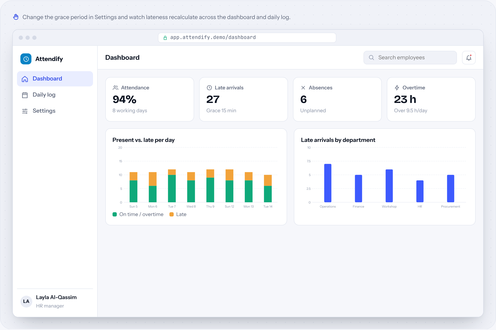
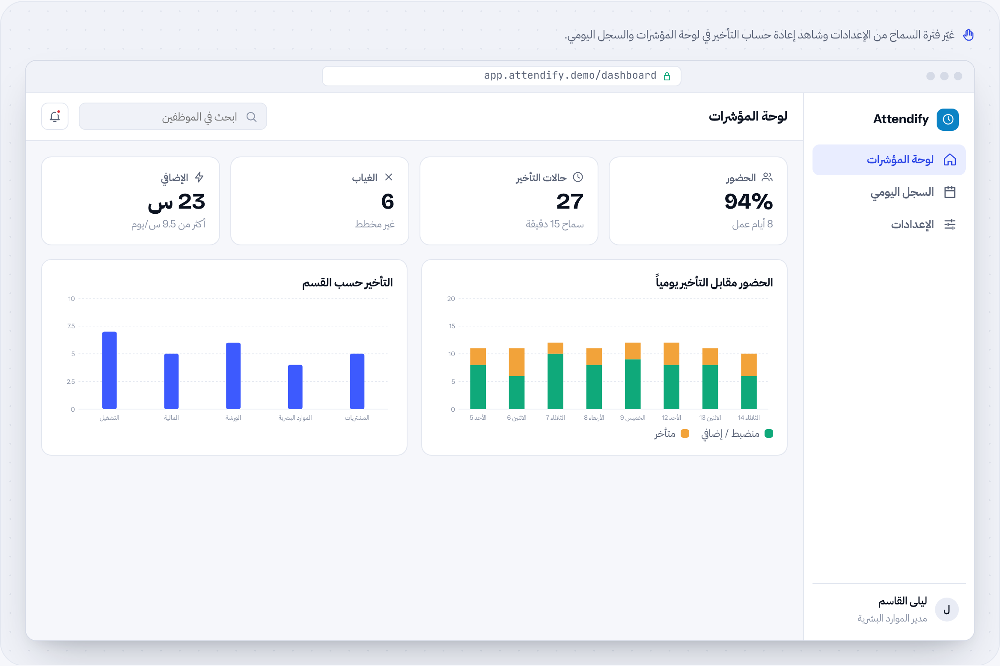

# Attendify

**Attendance & overtime system** · Business systems · by [HUDERA AI](https://www.linkedin.com/company/hudera)

Daily attendance with grace periods, night shifts, lateness and overtime reports that update themselves, and a dashboard for HR.

**[▶ Try the live demo](https://hudera-ai.github.io/attendify/)** · runs in your browser on sample data · Arabic & English

## The problem
Lateness, absence and overtime reports are prepared by hand every month, and rules like grace periods are applied inconsistently.

## What it does
Attendify records check-in and check-out, applies your grace period, weekend and overtime rules, handles shifts that cross midnight, and keeps every report current.

## Business value
HR spends its time on exceptions, not on building reports, and every employee is measured by the same rules.

## Features
| Feature | Details |
| --- | --- |
| Grace period | Change once, applies everywhere |
| Shifts & weekends | Night shifts handled |
| Exceptions | Late, absent, overtime |
| HR dashboard | By day and department |
| Departments | Filters and search |
| Protected formulas | Excel or web edition |

## How the workflow runs
**Record**: Check-in / out → **Rules**: Grace & shifts → **Classify**: On time · late · OT → **Report**: Daily & monthly → **Review**: HR dashboard

## Typical stack
Excel (formula engine) · or web app · Charts

## Run it locally
Open `index.html` in any modern browser. No build step, no server, no data leaves your machine.

---

## Attendify بالعربي

**نظام الحضور والإضافي**

حضور يومي بفترات سماح وورديات ليلية وتقارير تأخير وإضافي تتحدث تلقائياً، ولوحة مؤشرات للموارد البشرية.

### المشكلة
تقارير التأخير والغياب والإضافي تُجهَّز يدوياً كل شهر، وقواعد مثل فترة السماح تُطبَّق بشكل غير متسق.

### ما الذي يفعله
يسجّل Attendify الدخول والخروج، ويطبّق قواعد فترة السماح والإجازات والإضافي، ويتعامل مع الورديات التي تتجاوز منتصف الليل، ويبقي كل التقارير محدّثة.

### القيمة للأعمال
الموارد البشرية تركّز على الاستثناءات بدل إعداد التقارير، وكل موظف يُقاس بنفس القواعد.

### المزايا
| الميزة | التفاصيل |
| --- | --- |
| فترة السماح | تغيّرها مرة وتُطبَّق في كل مكان |
| الورديات والإجازات | دعم الورديات الليلية |
| الاستثناءات | تأخير، غياب، إضافي |
| لوحة الموارد البشرية | حسب اليوم والقسم |
| الأقسام | فلاتر وبحث |
| معادلات محمية | نسخة Excel أو ويب |

### كيف يسير العمل
**التسجيل**: دخول / خروج ← **القواعد**: السماح والورديات ← **التصنيف**: منضبط · متأخر · إضافي ← **التقرير**: يومي وشهري ← **المراجعة**: لوحة الموارد البشرية

---

## About HUDERA AI
HUDERA AI builds WhatsApp AI assistants, business dashboards, workflow automations and custom SaaS products for companies in Saudi Arabia and the Gulf.

- LinkedIn: [linkedin.com/company/hudera](https://www.linkedin.com/company/hudera)
- Email: hudera.ai@gmail.com
- WhatsApp: [+20 155 515 9139](https://wa.me/201555159139)

> This repository is a product demo. Company names, people and figures inside it are fictional sample data.

© 2026 HUDERA AI. All rights reserved.
