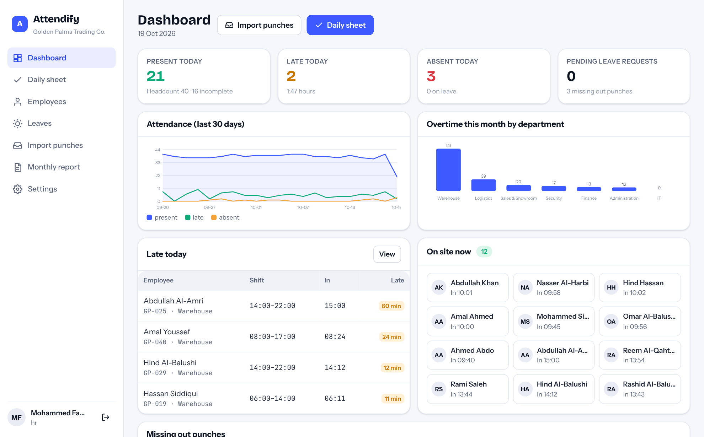
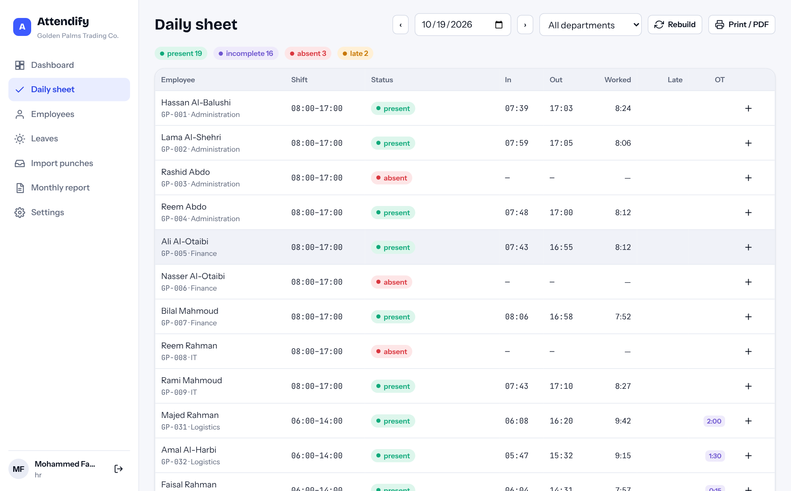
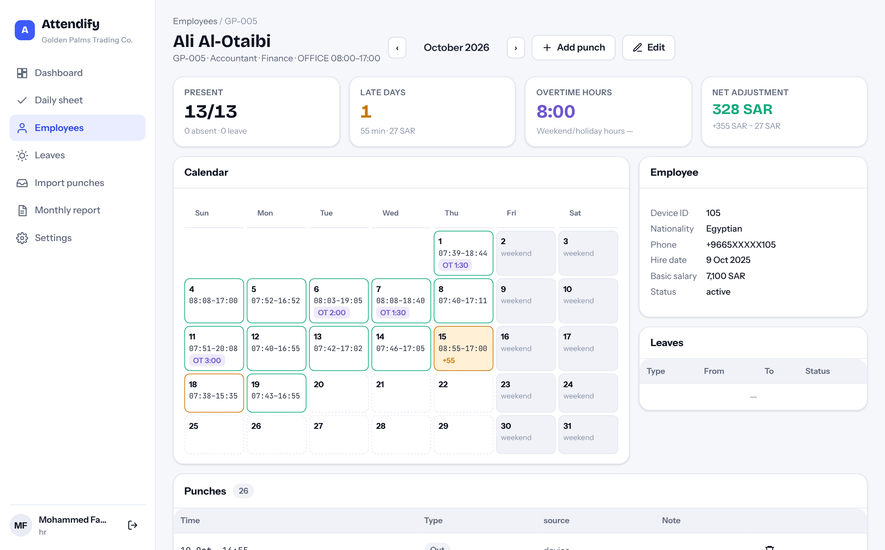
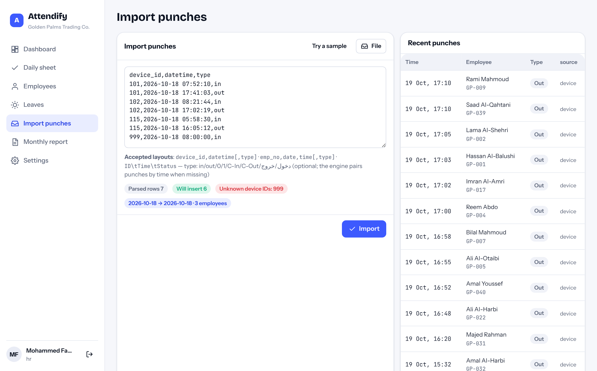
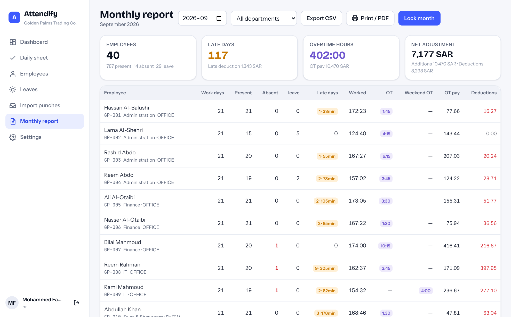
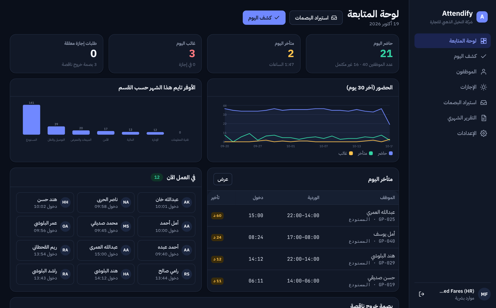

<p align="center"></p>
<h1 align="center">Attendify</h1>
<p align="center"><b>Attendance & overtime system.</b> Device punches → shifts, grace periods, lateness, overtime, leaves and holidays → the monthly report HR actually needs.<br>
<a href="https://hudera-ai.github.io/attendify/">Live demo</a> · <a href="#arabic">العربية</a> · built by <a href="https://hudera-ai.github.io">HUDERA AI</a></p>

<p align="center"></p>

A complete, working system. The same code runs in two ways:

| | How | Data |
|---|---|---|
| **Live demo** (GitHub Pages) | The web app runs SQLite inside your browser (sql.js / WebAssembly); the attendance engine runs there too. | Sample dataset (40 employees, ~3 months of punches), stored in your browser only. Reset from *Settings*. |
| **Self-hosted** | `npm start` → Node server with a REST API, sessions and a device push endpoint, serving the same web app. | SQLite file in `data/`. |

> Sample data: the company (*Golden Palms Trading Co.*), its people and figures are fictional and exist only to demonstrate the product.

## What it does

- **Rules engine** (`shared/engine.js`, unit-tested): shifts with breaks, shifts that cross midnight (night security), per-shift or company grace minutes, lateness and early-leave minutes, overtime rounded down to a step with a minimum threshold, weekend/holiday work at a separate rate, approved leaves, public holidays, missing-punch detection, "not started" vs. absent for today.
- **Import punches** from any fingerprint/face device export (CSV/TSV, headers optional, `in/out`, `0/1`, `C/In`, `دخول/خروج`) with a dry-run preview: rows parsed, duplicates, unknown device IDs, errors. A `POST /device/punch` endpoint accepts live pushes from a device bridge.
- **Daily sheet** per date and department: status, in/out, worked, late, overtime; add a manual punch in two clicks.
- **Employee page** with a month calendar (colour-coded days, late minutes, OT badges), summary, leaves and the raw punch list.
- **Leaves** (annual, sick, unpaid, business) with approval; approving rewrites the affected days.
- **Monthly report** per employee: work days, present/absent/leave, late days & minutes, worked hours, weekday and weekend overtime, OT pay, late and absence deductions — CSV export, print, and **month locking** so payroll figures stop changing.
- **Roles:** admin, HR, department manager (sees only their department), viewer. Audit log of every change.
- **Arabic / English UI**, RTL, light/dark, responsive.

## Run it locally

```bash
git clone https://github.com/hudera-ai/attendify.git
cd attendify
npm install
npm start            # → http://localhost:8789
```

Demo users (password `demo1234`): `huda@goldenpalms.example` (admin) · `hr@goldenpalms.example` (HR) · `salem@goldenpalms.example` (warehouse manager) · `viewer@goldenpalms.example` (read-only).

`npm run seed` resets the sample data · `npm test` runs the engine and workflow tests.

## Architecture

```
attendify/
├── index.html, src/, assets/     web app (vanilla ES modules, no build step)
│   └── src/api.js                one client interface, two transports: HTTP or in-browser SQLite
├── shared/                       code used by BOTH the server and the browser demo
│   ├── engine.js                 attendance rules, monthly summary, device-export parser
│   ├── service.js                every operation (employees, punches, leaves, attendance, reports)
│   ├── seed.js                   deterministic sample dataset
│   └── auth.js, dbx.js           PBKDF2 passwords (Web Crypto), SQL helper
├── server/src/                   Express API, sessions, device push endpoint
├── db/schema.sql                 SQLite schema
├── tests/                        node:test suite (14 tests)
└── docs/                         screenshots, API reference
```

REST reference: [docs/API.md](docs/API.md).

## Screenshots

| Daily sheet | Employee month |
|---|---|
|  |  |

| Import punches | Monthly report | Arabic, dark |
|---|---|---|
|  |  |  |

## Production notes

For a client deployment HUDERA AI typically adds PostgreSQL, a device bridge (ZKTeco/Hikvision/Suprema SDK or ADMS push), payroll export in the client's format (or integration with their HR system), employee self-service on WhatsApp (balance, requests), and the client's labour-law specific rules.

---

<a id="arabic"></a>
## Attendify بالعربية

**نظام الحضور والأوفر تايم:** بصمات الجهاز ← ورديات ودقائق سماح وتأخير وأوفر تايم وإجازات وعطل ← التقرير الشهري الجاهز للرواتب.

- **محرك قواعد** مختبر: ورديات باستراحات، ورديات تعبر منتصف الليل (أمن ليلي)، سماح لكل وردية، تأخير وانصراف مبكر، أوفر تايم مقرّب بحد أدنى، عمل العطل بمعامل مختلف، إجازات معتمدة وعطل رسمية، واكتشاف البصمة الناقصة.
- **استيراد البصمات** من أي جهاز (CSV/TSV) مع معاينة قبل الإدخال: السطور، المكرر، أرقام غير معروفة، الأخطاء. ونقطة استقبال مباشرة من الجهاز.
- **كشف يومي** بالتاريخ والقسم، و**صفحة موظف** بتقويم شهري ملوّن.
- **إجازات** باعتماد يعيد حساب الأيام تلقائيًا.
- **تقرير شهري** لكل موظف: أيام العمل، الحضور، الغياب، التأخير بالدقائق، ساعات الأوفر تايم العادي والعطل، مبلغ الأوفر تايم، وخصومات التأخير والغياب — تصدير CSV وطباعة و**قفل الشهر**.
- **صلاحيات:** مدير نظام، موارد بشرية، مدير قسم (يرى قسمه فقط)، مشاهد. سجل عمليات.
- **عربي/إنجليزي** مع RTL، فاتح وداكن، ويعمل على الموبايل.

> البيانات تجريبية: الشركة (النخيل الذهبي للتجارة) والأشخاص والأرقام كلها افتراضية لغرض العرض فقط.

**التشغيل:** `npm install` ثم `npm start` على `http://localhost:8789` — كلمة مرور المستخدمين التجريبيين `demo1234`.

---
© 2026 HUDERA AI · AI automation & SaaS products for businesses in Saudi Arabia and the Gulf · [hudera-ai.github.io](https://hudera-ai.github.io)
